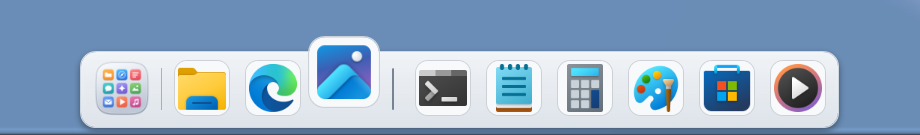
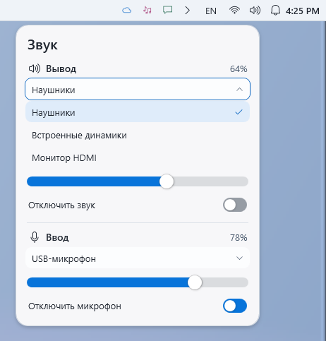
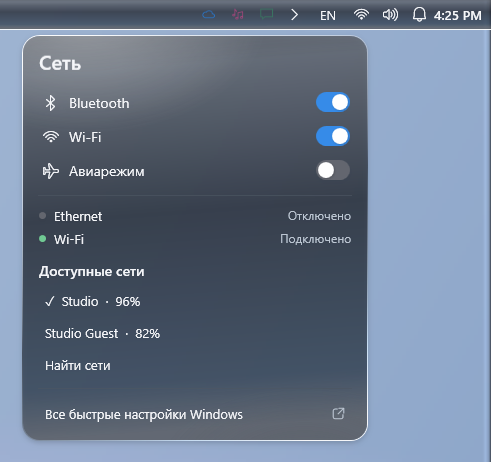
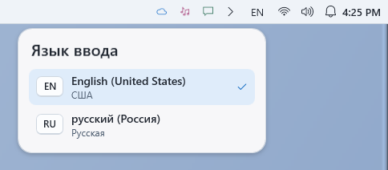
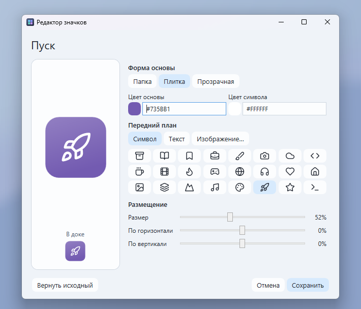
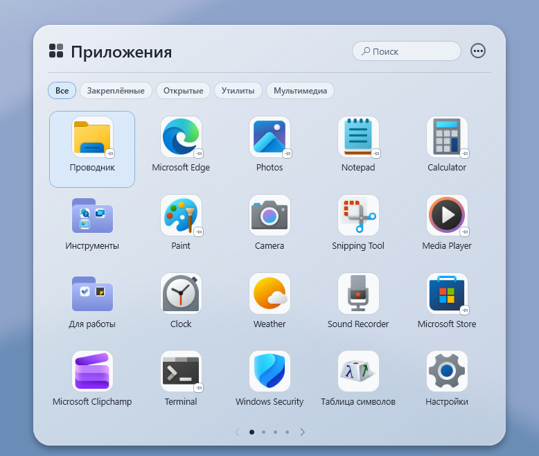
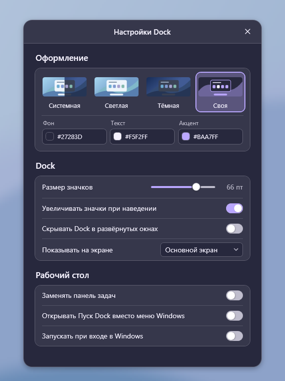

# Lunaris Dock

Панель Dock и меню приложений для Windows 11 x64. Закрепляйте приложения перетаскиванием, переключайтесь между их окнами и находите программы через поиск. Меню подхватывает папки из «Пуска» Windows и позволяет создавать свои.

## Установка

**[Скачать установщик для Windows 11 x64](https://github.com/Dosash/lunaris-dock/releases/download/v1.3.1.9/LunarisDock-1.3.1.9-x64-Setup.exe)** · Версия 1.3.1.9

Откройте скачанный файл и следуйте подсказкам мастера. Программа устанавливается для текущего пользователя и добавляет ярлык **Lunaris Dock** в меню «Пуск». Если уже открыта пробная копия, сначала щёлкните правой кнопкой по первому значку Dock и выберите **Выйти из Dock**.

## Интерфейс

Значок «Пуска» с сеткой из девяти приложений подстраивается под цвет темы. Меню плавно раскрывается из кнопки. При запуске приложения его значок в Dock слегка подпрыгивает. Щёлкните правой кнопкой по значку Dock, чтобы открыть Диспетчер задач или добавить разделитель между группами приложений.



### Верхняя строка

Стрелка раскрывает значки трея прямо в строке. Левый щелчок выполняет действие приложения, правый открывает его собственное меню. Колокольчик открывает центр уведомлений Windows.

**Звук** позволяет выбрать наушники или колонки и отдельно — микрофон. У каждого направления есть свой бегунок и переключатель отключения звука. В меню **Сеть** можно переключить Bluetooth, Wi-Fi и авиарежим, посмотреть состояние Ethernet, подключиться к беспроводной сети или отключиться от неё.

<p>
  <a href="docs/screenshots/sound.png"></a>
  <a href="docs/screenshots/network.png"></a>
</p>

В меню **Язык ввода** текущая раскладка отмечена галочкой. Выберите другую и продолжайте печатать в том же приложении. Устройства, сети и значки трея на снимках демонстрационные.

<a href="docs/screenshots/language.png"></a>

### Значки, Пуск и настройки

В редакторе можно собрать значок из формы, цвета и символа, добавить текст или импортировать PNG/ICO. Предпросмотр показывает, как он будет выглядеть в Dock. Редактор открывается из контекстного меню приложения, папки или кнопки «Пуск».

<a href="docs/screenshots/editor.png"></a>

<p align="center">
  <a href="docs/screenshots/start.png"></a>
  <a href="docs/screenshots/settings.png"></a>
</p>

## Портативная версия

1. Для запуска без установки скачайте [портативную версию в ZIP](https://github.com/Dosash/lunaris-dock/releases/download/v1.3.1.9/LunarisDock-1.3.1.9-x64-Portable.zip) и распакуйте архив целиком.
2. Откройте **Тестовый запуск.cmd**. В пробном режиме панель задач и клавиша Win работают как обычно. Нажмите первый значок Dock, чтобы открыть меню приложений.
3. Чтобы выйти, щёлкните правой кнопкой по первому значку и выберите **Выйти из Dock**. Для обычного режима запустите **LunarisDock.exe**. В нём можно открывать меню Dock клавишей Win и включать замену панели задач в настройках.

## Настройка

В контекстном меню Dock выберите **Настройки…**. Там можно изменить размер значков, включить скрытие поверх полноэкранных окон и выбрать экраны для панели. В оформлении доступны системная, светлая, тёмная и своя темы. В своей теме фон, текст и акцент меняются сразу.

У портативной версии закрепления, папки и настройки хранятся рядом с программой в `Data\Preview` для пробного режима и `Data\Profile` для обычного. Для переноса на другой компьютер скопируйте распакованную папку целиком.

## Сборка и проверка

Для портативной сборки нужны Windows 11 x64, PowerShell и .NET Framework 4.8 или новее. Запустите следующие команды из корня проекта.

```powershell
.\build.ps1 -PortableOnly
.\tests\Portable.Tests.ps1 -PackageOnly
```

Готовый архив появится в `release\1.3.1.9`. Команда `.\build.ps1` также собирает установщик с помощью Inno Setup. При первом запуске скрипт загружает компилятор и сверяет его SHA-256. Для установленного компилятора можно передать путь к `ISCC.exe` через `-Iscc`.

В сборке из этих исходников установщик предлагает English, Русский, Deutsch, Español и 简体中文. Выбранный язык используется и при первом запуске Dock. Позже его можно сменить в **Настройки… → Оформление → Язык**. Там же переключатель **Liquid Glass** добавляет полупрозрачность и световые блики к выбранной теме. Обе настройки применяются сразу. Чтобы увидеть эффект стекла, включите эффекты прозрачности Windows и используйте обычную контрастность.

Установщик создаёт ярлык **Lunaris Dock** на рабочем столе. Чтобы Dock открывался при входе в Windows, поставьте галочку автозапуска в мастере. Позже это можно изменить в настройках Dock.

Перетащите ярлык приложения из Проводника на панель Dock туда, где хотите его закрепить. Для обычной программы Dock сохраняет путь к EXE. После этого исходный ярлык можно переместить или удалить. При появлении и исчезновении значков соседние элементы плавно сдвигаются. Dock учитывает системную настройку анимации.

Папку тоже можно перетащить на Dock. Щелчок по папке из Проводника откроет её в Проводнике, а по папке из Пуска Lunaris — покажет её содержимое в Пуске. В меню папки Пуска также есть команда **Закрепить в Dock**.

Чтобы разделить закреплённые программы на группы, щёлкните правой кнопкой по значку или пустому месту на панели и выберите **Добавить разделитель**. Перетащите линию между программами. Чтобы убрать её, выберите **Удалить разделитель** в меню самой линии.

Чтобы оформить приложение, папку или кнопку Пуска в Lunaris, выберите **Изменить значок…** в её контекстном меню. Для нескольких значков включите **Редактировать значки левым щелчком** в меню Dock или в меню действий Пуска. В редакторе выберите форму и цвета, добавьте символ, надпись или своё изображение PNG/ICO. Предпросмотр показывает результат крупно и в размере для дока. После сохранения выберите **Завершить редактирование значков**, чтобы снова открывать приложения левым щелчком.

Верхняя строка использует выбранную тему и Liquid Glass. Чтобы скрыть или вернуть её, откройте **Настройки → Рабочий стол → Показывать верхнюю строку меню**.

Когда на GitHub выходит более новая версия, на значке **Пуск** появляется метка. Щёлкните по значку правой кнопкой и откройте **Настройки…**. Там указаны установленная версия, ссылка на проект и ссылка на страницу нового релиза. Метку можно отключить отдельно.

Для работы с кодом откройте [краткую памятку](AGENTS.md) или [справочник разработчика с картой исходников и сценариями проверок](docs/DEVELOPMENT.md).

## 💖 Поддержать

Если вам нравится Lunaris Dock, вы можете поблагодарить автора и поддержать разработку.

[CloudTips](https://pay.cloudtips.ru/p/894f4248) (карта)

## Лицензия

Проект распространяется под [лицензией MIT](LICENSE).

Встроенные символы для конструктора значков взяты из [Lucide](https://github.com/lucide-icons/lucide). Условия использования Lucide и входящих в него символов Feather приведены в [файле лицензий](packaging/Lucide-LICENSE.txt). Идея собирать значок из цветной основы и собственного рисунка вдохновлена [FolderArt](https://github.com/christianvmm/folderart).
